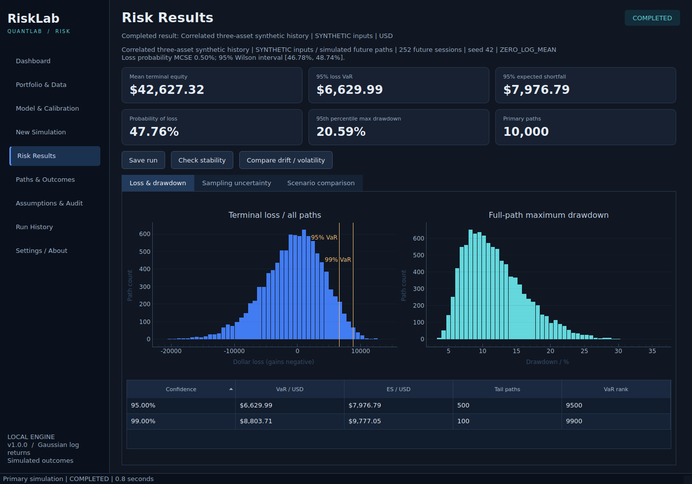

# RiskLab

**QuantLab / Risk - Aiden Federico-Dyer - v1.0.0 source release**

RiskLab is an independent Python/PySide6 desktop application for studying
portfolio outcomes under a declared correlated Gaussian daily log-return
model. It makes terminal loss, expected shortfall, probability of loss,
per-path maximum drawdown, and Monte Carlo sampling uncertainty inspectable.



This is actual engine output from the application using Qt's offscreen
platform. The bundled calibration history is **SYNTHETIC** and future paths
are **SIMULATED**. The picture is not a UI mockup or real investment performance.

## Start on Windows

1. Extract the **entire** source ZIP, keeping its folders together.
2. Install Python **3.12** with its Windows `py` launcher if needed.
3. Double-click **Setup_Windows.cmd** once.
4. Double-click **Launch_RiskLab.cmd**.
5. On Dashboard choose **Load synthetic demo**.
6. Open **New Simulation**, retain the defaults, and choose **Run simulation**.

The setup installs pinned dependencies in a local `.venv`. The launcher uses
that environment directly; activation and PowerShell execution-policy changes
are unnecessary. Project paths with spaces are quoted by the scripts.

For a visible diagnostic console, open a terminal in the extracted project:

```powershell
.\.venv\Scripts\python.exe -m risklab
```

**The source ZIP contains no Windows executable.** `Build_Windows.cmd` installs
test/build dependencies, runs the suite, builds with PyInstaller, and tests the
packaged offscreen workflow. Expected output on Windows is
`dist\RiskLab\RiskLab.exe`. The whole `dist\RiskLab` folder must travel together.
Native Windows build, double-click runtime, and high-DPI behavior are
**UNVERIFIED on this Linux verification host**. A native Linux package was
actually built and tested; it does not establish Windows verification.

## Included workflows

- Nine views: Dashboard, Portfolio & Data, Model & Calibration, New Simulation,
  Risk Results, Paths & Outcomes, Assumptions & Audit, Run History, Settings/About.
- Editable USD portfolio with one to ten assets, fractional nonnegative shares,
  fixed cash, and explicit starting prices/date.
- Validated synthetic presets and RAW action-free price-history import with a
  matching metadata file. No calendar inference, forward filling, or downloads.
- Historical log-mean/sample-covariance estimation, zero-log-mean mode, manual
  parameter models, labeled covariance/correlation matrices, and PSD diagnostics.
- Batched seeded simulation, worker-thread execution, progress, and cancellation.
- Signed terminal loss, empirical VaR/ES, Wilson loss-probability interval,
  per-path drawdown, all-outcome tables, filtering, numeric sorting, and copy.
- Bootstrap VaR/ES intervals and two independent repeat simulations. A heuristic
  flags unstable estimates; no flag is not a certificate of model realism.
- Paired drift/volatility comparisons at identical holdings and horizon.
- Verified immutable run folders, ZIP export, restart/reopen without refitting
  or resimulating, and corruption reporting.

## First demo and saved results

The correlated demo has three fictional assets and 756 complete synthetic
return observations. Defaults are 10,000 primary paths, 252 future sessions,
seed 42, batch size 512, 20 displayed paths, 95%/99% confidence, and zero log mean.
The generated quantities and sample outcomes are documented in [DEMO](docs/DEMO.md).

Run **Check stability**, then **Compare drift / volatility**, and inspect the
three result tabs. **Save run** creates a new immutable folder in the configured
workspace. After diagnostics change a result, save a new revision. Previously
saved folders remain unchanged. Run History can verify/open folders, export a
portable ZIP, and show their locations.

To inspect the included completed example, choose **Run History > Open run
folder...**, then the hashed folder inside `examples/completed_runs`. Choose the
folder containing `manifest.json` and `COMPLETED`, not the parent directory.
It opens stored outcomes without recalibration or stochastic execution.

All statistical summaries use **every primary path**. The equity chart retains
only a declared small subset, selected without consuming the simulation RNG.
A path's full trajectory is available only when it is a retained preview ID;
terminal equity and maximum drawdown are available for every path.

## Model contract and boundaries

Each session uses `g ~ Normal(m, Sigma)` and `S_next = S * exp(g)`.
`m` is already mean **daily log return**; there is no extra half-variance
subtraction. Zero log mean does not mean zero expected arithmetic return.
Holdings and cash remain fixed. No execution, transaction costs, dividends,
splits, leverage, FX, options, cash interest, or rebalancing are modeled.

Loss is `initial equity - terminal equity`, with gains negative. VaR uses the
one-based rank `ceil(alpha*N)`. ES averages the largest `ceil((1-alpha)*N)`
losses. Neither is floored at zero. Every selected tail requires 100 paths;
99% confidence requires at least 10,000 paths under the declared convention.
Drawdown is computed within each full path from its own running peak.

Gaussian assumptions omit jumps, serial dependence and volatility clustering.
Sampling error is distinct from uncertain calibration parameters and an
inadequate real-world model. Imported RAW histories require an explicit
`action_free: true` declaration; user declarations are not independently
verified. Total-return indices and adjusted-price modes are not supported.
See [data contracts](docs/DATA_FORMAT.md), [risk measures](docs/RISK_METRICS.md),
and [assumptions](docs/MODEL_ASSUMPTIONS.md).

## Verification and development

See [testing evidence](docs/TESTING.md), [engineering report](docs/ENGINEERING_REPORT.md),
[reproducibility](docs/REPRODUCIBILITY.md), and [packaging](docs/PACKAGING.md).
The suite includes deterministic acceptance fixtures, an independent scalar
reference, statistical moment/covariance checks, persistence failures, and
real Qt workflow tests. Native-display and Windows checks remain separate.

```powershell
.\.venv\Scripts\python.exe -m pip install -r requirements-dev.txt
.\.venv\Scripts\python.exe -m pytest
```

On Linux, create a Python 3.12 environment, install `requirements-dev.txt`, then
use its `python -m risklab`. Verification here used `QT_QPA_PLATFORM=offscreen`
and `OPENBLAS_NUM_THREADS=1`. These are verification settings, not requirements
for ordinary Windows launching.

The optional CLI uses the same validated workflows:

```powershell
.\.venv\Scripts\python.exe -m risklab --headless --scenario examples\correlated_history.json --out runs --diagnose --compare
```

No other QuantLab application is required at runtime. Meaningful Git history
is included in `RiskLab_History.bundle`; [GitHub instructions](docs/GITHUB.md)
explain how to restore it without accidentally initializing a user-home repo.
